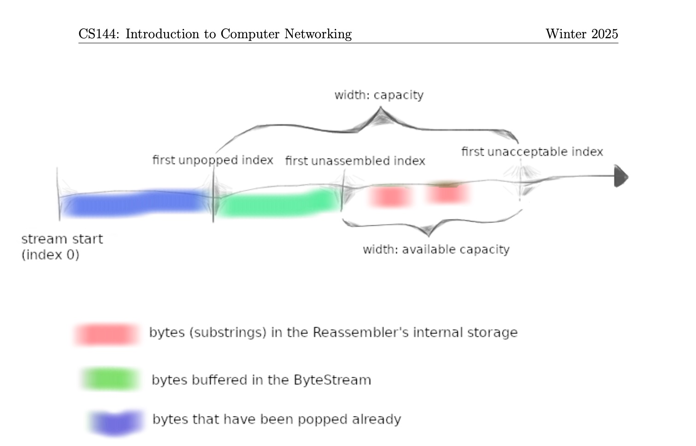

# 前情提要
我学习的课程是cs144 winter 2025

这个笔记只包括checkpoint0到checkpoint4的内容，由于每个人学习的进度不同，加上个人时间有限，我也不想一个人全部讲完，checkpoint5,6就没有涉及到。

总的来说，代码量不算很大，因为cs144已经提供了很扎实的框架，在理解了逻辑后，更像是一份代码填空题。所以感觉还是有必要读一读提供的框架代码的。

当然，还有很多是这门课程没有涉及到的细节。比如TCP三次握手，拥塞控制，流量控制（其实这里面也有体现，比如window_size_），如何将receiver和sender整合成一个完整的TCPpeer？课程代码是如何用我们实现的TCP“代替”掉操作系统提供的实现的？（当然，这里不是指用我们的课程代码替换掉操作系统实现的TCP代码）等等，总之虽然做完了cs144，还是有很多东西我没有掌握。

## checkpoint 0
### 体验监听与连接
```
cs144@cs144vm:~$ telnet cs144.keithw.org http
Trying 198.18.1.90...
Connected to cs144.keithw.org.
Escape character is '^]'.
GET /hello HTTP/1.1
Host: cs144.keithw.org
Connection: close

HTTP/1.1 200 OK
Date: Wed, 14 Oct 2026 10:17:38 GMT
Server: Apache/2.4.66 (Ubuntu)
Last-Modified: Thu, 13 Dec 2018 15:45:29 GMT
ETag: "e-57ce9343a1840"
Accept-Ranges: bytes
Content-Length: 14
Connection: close
Content-Type: text/plain

Hello, CS144!
Connection closed by foreign host.
cs144@cs144vm:~$ 
```
这里模拟了浏览器向服务器发送http请求的过程

下面是监听与连接，模拟服务器监听本地端口9090，等待在9090端口的程序主动请求连接，并接受请求。连接建立后双方可以相互通信

下面是服务端
```
cs144@cs144vm:~$ netcat -v -l -p 9090
Listening on 0.0.0.0 9090
Connection received on localhost 33864
hello server
hello client
^C
cs144@cs144vm:~$ 
```
下面是客户端
```
cs144@cs144vm:~$ telnet localhost 9090
Trying 127.0.0.1...
Connected to localhost.
Escape character is '^]'.
hello server
hello client
Connection closed by foreign host.
cs144@cs144vm:~$ 
```
当然，这只是体验了一下在真实的网络世界中双方是如何通信的。接下来，需要使用操作系统已经实现好的流式socket编写网络程序，自己实现通信中的基本步骤，具体就是编写webget：

主要实现下面4个步骤：
1. 由socker建立TCP连接
2. 拼好请求，再调用write()发送HTTP请求
3. 调用read(),再输出回复
4. 一旦代码读到EOF后就结束连接

```cpp
void get_URL( const string& host, const string& path )
{
  TCPSocket socket;//创建 TCP 套接字
  Address address=Address(host,"http");//把域名和服务名解析为地址
  socket.connect(address);//连接服务器
  const string request = "GET " + path + " HTTP/1.1\r\n"
                         "Host: " + host + "\r\n"
                         "Connection: close\r\n\r\n";
  string response;
  socket.write(request);
  while ( !socket.eof() ) {
    socket.read(response);
    cout<<response;
  }
}
```
### ByteStream
进入正题，你已经看到，尽管互联网只提供不可靠、尽力交付的数据报，可靠字节流抽象仍使通信非常方便。

ByteStream的作用就是在单台电脑的内存中实现提供这种抽象的对象。`ByteStream` 本身完全不管网络丢包或者乱序，它只是一个有界 FIFO 缓冲区。至于超时重传，乱序到达的重排会在后面的类中实现。
```cpp
#pragma once

#include <cstdint>
#include <string>
#include <string_view>
#include<deque>
class Reader;
class Writer;

class ByteStream
{
public:
  explicit ByteStream( uint64_t capacity );

  // Helper functions (provided) to access the ByteStream's Reader and Writer interfaces
  Reader& reader();
  const Reader& reader() const;
  Writer& writer();
  const Writer& writer() const;

  void set_error() { error_ = true; };       // Signal that the stream suffered an error.
  bool has_error() const { return error_; }; // Has the stream had an error?

protected:
  // Please add any additional state to the ByteStream here, and not to the Writer and Reader interfaces.
  uint64_t capacity_;
  bool error_ {};
  std::deque<std::string> chunks_ {};
  uint64_t front_offset_{};//{}代表默认初始化，这里初始化为0
  uint64_t bytes_pushed_{};
  uint64_t bytes_popped_{};
  bool closed_{};//初始化为false
};

class Writer : public ByteStream
{
public:
  void push( std::string data ); // Push data to stream, but only as much as available capacity allows.
  void close();                  // Signal that the stream has reached its ending. Nothing more will be written.

  bool is_closed() const;              // Has the stream been closed?
  uint64_t available_capacity() const; // How many bytes can be pushed to the stream right now?
  uint64_t bytes_pushed() const;       // Total number of bytes cumulatively pushed to the stream
};

class Reader : public ByteStream
{
public:
  std::string_view peek() const; // Peek at the next bytes in the buffer
  void pop( uint64_t len );      // Remove `len` bytes from the buffer

  bool is_finished() const;        // Is the stream finished (closed and fully popped)?
  uint64_t bytes_buffered() const; // Number of bytes currently buffered (pushed and not popped)
  uint64_t bytes_popped() const;   // Total number of bytes cumulatively popped from stream
};

/*
 * read: A (provided) helper function thats peeks and pops up to `max_len` bytes
 * from a ByteStream Reader into a string;
 */
void read( Reader& reader, uint64_t max_len, std::string& out );

```
在byte_stream.hh中你可以看到reader和writer都是ByteStream的派生类，但是课程中说明不允许reader和writer有自己的派生类。

因为课程中是通过将一个byteStream分别向下转型为reader和writer，保证这两个reader和writer可以共享同一块成员变量的内存。这个也很容易理解，因为在逻辑上如果writer写入了数据到缓冲区，reader也应该看到同样的数据。如果reader和writer还有自己的成员变量，可能导致向下转型失败。你可以把它们理解为操作抽象字节流的两个接口
Writer 接口：

```cpp
// 写入数据，但实际写入量不得超过当前剩余容量。
void push( std::string data );
// 表示流到达结束位置；此后不会再写入。
void close();
// 流是否已关闭？
bool is_closed() const;
// 当前还能写入多少字节？
uint64_t available_capacity() const;
// 累计写入过多少字节？
uint64_t bytes_pushed() const;
```

Reader 接口：

```cpp
// 查看缓冲区中接下来的字节。
std::string_view peek() const;
// 从缓冲区移除 len 个字节。
void pop( uint64_t len );
// 流是否已结束：Writer 已关闭，且缓冲字节都已移除？
bool is_finished() const;
// 流是否发生错误？
bool has_error() const;
// 当前缓冲的字节数：已写入、尚未移除。
uint64_t bytes_buffered() const;
// 累计移除过多少字节？
uint64_t bytes_popped() const;
```
用ai帮我制作了一个字节索引区间图

其实只要维护bytes_popped_和bytes_pushed_就行，capacity初始化的时候就确定了。
bytes_buffered_和available_capacity可以通过前三者计算出来。
```cpp
bytes_buffered=bytes_pushed_-bytes_popped_;
available_capacity=capacity_-bytes_buffered;
```
我们在push,pop的时候必须维护这两个不变量，更新bytes_pushed_和bytes_popped_，注意bytes_pushed_都是只增不减的

字节从输入端写入，从输出端按相同顺序读出。所以需要一个FIFO的数据结构来记录字节流。我的实现用的是std::deque<std::string> chunks_。

字节流是有限的：Writer 可以结束输入，此后不能再写入。Reader 读到流的末尾时将到达 EOF，此后不能再读取新字节。

其次，如何判断EOF也是一个重要的点。实际上，ByteStream并不会接受到一个真实的EOF字节，而是通过判断writer是否已经关闭输入，是否还有缓存的字节来判断是否还能读取新字节。
```cpp
bool Reader::is_finished() const
{
  return closed_&&(bytes_buffered()==0); // Your code here.
}
```
写到这里发现好像说了太多的废话hhh
那接下来讲下我从这些接口的实现中学到了什么？

首先是peek()接口的实现。一开始我不理解为什么还要有peek，觉得这个接口有点鸡肋，直接pop（len）不就好了吗？
但是发现如果直接pop的话，可能会丢失没有被socker真正写入的数据
```
auto view = reader.peek();          // string_view，不复制字符
size_t len = socket.write(view);   // 实际接受了多少字节
reader.pop(len);                   // 移除对应字节
```
先查看可以接受的字符串，再根据实际的接受量来移除，是更好的方式

另外这里还有一个比较重要，我认为也是这个bytestream类中最精彩的设计————front_offset游标，这个变量记录的是当前队列第一个元素已经被读取了多少个字节，负责记录读取进度。

每当我想要peek现在能读取的字符串，我只需要返回view.substr(front_offset_);其中view=string_view{chunks_.front()}。

更重要的是pop时会先检查front_offset_== 
chunks_.front().size()，如果相等，就说明读取完了第一个字符串，此时才会chunks.pop_front()避免了频繁chunks.front.erase()带来的性能开销（毕竟要把留下来的字符串重新复制一遍）
```cpp
string_view Reader::peek() const
{ 
  if(chunks_.empty()){
    return {};
  }
  string_view view=string_view{chunks_.front()};
  string_view result=view.substr(front_offset_);
  return result;
}

void Reader::pop( uint64_t len )
{ 
  uint64_t remaining=min(len,bytes_buffered());
  while(remaining>0){
    uint64_t available_in_front=chunks_.front().size()-front_offset_;
    uint64_t amount=min(remaining,available_in_front);
    front_offset_+=amount;
    bytes_popped_+=amount;
    remaining-=amount;
    if(front_offset_== chunks_.front().size()){
      chunks_.pop_front();
      front_offset_=0;
    }
  }
}
```
## checkpoint1

Reassembler：把乱序片段还原成连续字节流

TCP 发送端会将字节流切成多个报文段。网络可能让这些报文段乱序到达、重复到达，或者丢失。

例如，原始数据是 `ABCDEFGH`，接收端却可能先收到 `CDE`，再收到 `ABCDEFGH`。

而我们在 checkpoint 0 中实现的 ByteStream 只能按顺序追加数据：不能先写入 `CDE`，之后再把 `AB` 插到前面。因此，需要 Reassembler 处理乱序与重叠，将连续的数据交给 ByteStream。

### Reassembler 需要完成什么？

它的主要接口是：

```cpp
void insert(
  uint64_t first_index,
  std::string data,
  bool is_last_substring
);
```

三个参数分别表示：

- `first_index`：片段首字节的流索引，从 0 开始。
- `data`：片段包含的数据。
- `is_last_substring`：这个片段的末尾是否标记了整个流的结束。（其实就是FIN）

注意，最后一个参数不是“这个片段是否最后到达”。**包含流末尾的片段，也可能比前面的数据更早到达。**

每次插入后，Reassembler 应尽可能将连续的数据写入 ByteStream；暂时接不上的数据则保存在内部，等待缺口被补齐。

### 如何表示已经收到的数据？
对于那些到了但是前面还有缺口、暂时没法塞进ByteStream的片段，我用pending_来存：

```cpp
std::map<uint64_t, std::string> pending_;
```

键是片段的起始流索引，值是片段内容。例如：

```cpp
pending_ = {
  {2, "CDE"}
};
```

表示已经收到索引2、3、4的字节，但前面的字节尚未拼齐。

pending_这里始终维护两个约束：

1. pending_中的片段互不重叠，同一个字节不重复保存。
2. 已经交给 ByteStream 的字节，不再保存在pending_中。

**相邻片段可以分开保存，不必合并成一个大字符串。** 只要它们不重叠，在逻辑上是连续的就行。

另一个重要状态是：

```cpp
writer.bytes_pushed()
```

它表示累计交给 ByteStream 的字节数，也就是**下一个等待重组的流索引**。

例如，它等于 `2`，说明索引 `[0, 2)` 已经交付，现在等待索引 `2` 开始的数据。应用从 ByteStream 中读走数据，不会让这个累计计数减少。

实现可以归纳成三步：

**裁剪接收范围 → 只保存未覆盖的字节 → 尽可能交付连续片段。**

### 确定新片段中允许接收的范围

不是所有收到的字节都需要保存：

- 已经交付过的字节，不需要再次保存。
- 超出当前接收窗口的字节，不能保存。
- 窗口内尚未交付的字节，才需要进一步处理。

结合容量示意图，可以把整个流分成三个区域：



- 蓝色区域：已经被应用从 ByteStream 读走。
- 绿色区域：已经重组并写入 ByteStream，但应用尚未读走。
- 后面的窗口区域：可能已经收到一些片段，也可能仍有缺口。

**重复和重叠是新片段与已有数据之间的关系，不代表内部需要重复保存这些字节。**

当前允许接收的窗口是：

```cpp
const uint64_t unassembled = writer.bytes_pushed();
const uint64_t unacceptable =
  unassembled + writer.available_capacity();
```

即左闭右开区间：

```text
[unassembled, unacceptable)
```

新片段自身的范围是：

```text
[first_index, original_end)
```

取两者的交集：

```cpp
const uint64_t accepted_begin = max(first_index, unassembled);
const uint64_t accepted_end = min(original_end, unacceptable);
```

这里需要区分：

**`[unassembled, unacceptable)` 是接收窗口；`[accepted_begin, accepted_end)` 是这一次新片段落在窗口内的部分。**

### 只保存尚未覆盖的部分

使用两个变量：

```cpp
uint64_t scan_position = accepted_begin;
auto it = pending_.lower_bound(scan_position);
```

- `scan_position`：接下来需要检查的位置。
- `it`：当前检查的已有片段。

扫描过程中维护的不变量是：

**新片段中位于扫描位置之前的有效部分，都已经处理过：要么原本已经存在，要么刚刚保存。**

遇到一个已有片段时，只做两件事：

1. 如果扫描位置与已有片段起点之间有空隙，保存空隙中的新字节。
2. 跳过已有片段覆盖的部分，继续向右检查。

扫描结束后，如果新片段还有未处理的尾部，再保存尾部。

#### 为什么 lower_bound 后还要检查前一个片段？

`lower_bound(accepted_begin)` 找到的是：

> 起点不小于 `accepted_begin` 的第一个已有片段。

但**起点更小的片段，也可能延伸到 `accepted_begin` 之后**。

例如：

```text
已有片段：[2, 5)，内容为 "CDE"
新片段：  [3, 7)，内容为 "DEFG"
```

已有片段从 `2` 开始，虽然在新片段左边，却覆盖了新片段中的 `[3, 5)`。

因此，还要检查 `lower_bound()` 返回位置的前一个片段：

```cpp
if (it != pending_.begin()) {
  auto previous = prev(it);

  const uint64_t previous_end =
    previous->first + previous->second.size();

  if (previous_end > accepted_begin) {
    it = previous;
  }
}
```

由于 `pending_` 中的片段互不重叠，只需要检查紧邻的前一个，不必继续向前搜索。

### 尽可能交付连续数据

处理完新片段后，不断查找：

```cpp
pending_.find(writer.bytes_pushed())
```

如果找到，说明这个片段恰好接在已经交付的数据后面，可以写入 ByteStream，并从 `pending_` 中删除。

写入后，`bytes_pushed()` 会前进，接着查找下一个片段。

这里需要循环，因为**一次插入可能补上缺口，让后面多个早已收到的片段一起变得连续**。

如果找不到，则说明下一个需要的位置仍然缺失，停止交付，等待后续插入即可。

### 一个例子

假设容量足够，当前：

```cpp
writer.bytes_pushed() == 0;
pending_ = {
  {2, "CDE"}
};
```

现在插入：

```cpp
insert(0, "ABCDEFGH", false);
```

新片段覆盖 `[0, 8)`，已有片段覆盖 `[2, 5)`。

扫描过程如下：

1. `[0, 2)` 尚未保存，加入 `"AB"`。
2. `[2, 5)` 已经有 `"CDE"`，跳过。
3. `[5, 8)` 尚未保存，加入 `"FGH"`。

此时：

```cpp
pending_ = {
  {0, "AB"},
  {2, "CDE"},
  {5, "FGH"}
};
```

接着开始交付：

1. 当前期待索引 `0`，写入 `"AB"`，`bytes_pushed()` 变成 `2`。
2. 当前期待索引 `2`，写入 `"CDE"`，计数变成 `5`。
3. 当前期待索引 `5`，写入 `"FGH"`，计数变成 `8`。
4. 找不到从索引 `8` 开始的片段，停止。

最终，ByteStream 得到 `ABCDEFGH`，`pending_` 为空。重叠的 `"CDE"` 没有被重复保存或交付。

### 什么时候关闭 Writer？

如果 `is_last_substring` 为真，就记录整个流的结束索引：

```cpp
eof_index_ = first_index + data.size();
```

这个位置必须用**裁剪前的原始片段**计算，因为容量裁剪不应该改变原始流在哪里结束。

但收到结束标记，并不代表前面的数据已经全部收到。

只有：

```cpp
writer.bytes_pushed() == eof_index_.value()
```

才表示结束位置之前的所有字节已经连续交付，此时才能调用：

```cpp
writer.close();
```

关闭 Writer 表示不会再有新数据写入；ByteStream 中已经缓冲的数据，仍然可以被 Reader 继续读取。
## checkpoint2
在 checkpoint 1 中，Reassembler 根据流索引重组字节片段。但真实的 TCP 报文并不直接携带流索引，而是使用 32 位序列号标识数据的位置。此外，建立和结束数据流的 SYN、FIN 也会占用序列号。
因此，TCPReceiver 需要将 TCP 的序列号转换为 Reassembler 使用的流索引，并根据已经连续接收的数据，生成确认号和接收窗口。

### 各种各样的序列号和它们之间的转换
| 名称 | 含义 | 是否计算 SYN、FIN |
|---|---|---|
| 32 位序列号 `seqno` | 报文中携带的位置标识，从 ISN 开始并按 \(2^{32}\) 回绕 | 是 |
| 绝对序列号 | 相对于 ISN 的位置，SYN 位于 0 | 是 |
| 流索引 | 数据字节在原始字节流中的位置，从 0 开始 | 否 |
例如，设ISN为100，发送的数据是ABC：
| 内容 | 32 位序列号 | 绝对序列号 | 流索引 |
|---|---:|---:|---:|
| SYN | 100 | 0 | 不适用 |
| A | 101 | 1 | 0 |
| B | 102 | 2 | 1 |
| C | 103 | 3 | 2 |
| FIN | 104 | 4 | 不适用 |
checkpoint2要我们实现一个工具类wrap32，wrap()负责将绝对序列号转换为32位序列号seqno,unwrap()负责将32位序列号seqno还原为绝对序列号。

具体来讲：
$$
\text{seqno}=(\text{ISN}+n)\bmod 2^{32}
$$
其中 $n$是绝对序列号。
unwrap() 不能简单地反过来计算，因为回绕以后，同一个 32 位序列号会对应多个绝对序列号。
设：
$$
r=(\text{seqno}-\text{ISN})\bmod 2^{32}
$$
那么候选位置包括：
$$
r,\quad r+2^{32},\quad r+2\cdot2^{32},\ldots
$$
checkpoint 提供当前位置的参考，unwrap() 从候选位置中选择距离它最近的一个。

在receiver中，我使用了writer().bytes_pushed() + 1作为参考位置，因为bytes_pushed()记录已经连续重组的数据字节数，加上SYN占用的一个位置，就得到接受进度在绝对序列中的位置
当然这样也无法保证绝对可以恢复绝对序列号。

### Receiver
#### receive
##### RST&SYN
收到RST时，Receiver就会设置流的错误状态。
在没有获得ISN时，只有带 SYN 的报文才能建立序列号起点。没有 SYN 的普通报文无法定位，应忽略。
##### 处理报文流索引
先通过 unwrap() 得到报文起点的绝对序列号。然后计算载荷的流索引：
$$
\text{流索引}
=
\text{报文起点的绝对序列号}
+
\begin{cases}
1,&\text{报文携带 SYN}\\
0,&\text{否则}
\end{cases}
-1
$$

1. 如果报文携带 SYN，载荷位于 SYN 后面，因此先加 1。
2. 流索引不计算最开始的 SYN，因此再减 1。

还有一种解释能够统一两种不同的做法：我们要求的是流索引，通过前面对流索引和绝对索引的观察可以知道，流索引等于绝对索引-1，当然了，SYN和FIN没有流索引，所以我们只要把真实数据的绝对索引计算出来再减1就行了。

那具体怎么计算呢？仅仅通过unwrap(seqno,checkpoint)是不够的。对于含有ISN的报文来说，此时的message.seqno==SYN的绝对序列号，而不是message.payload中的数据的绝对序列号。由于SYN也占用一个绝对序列号，payload中的数据序列号就等于报文的绝对序列号+1。

对于不含SYN的报文，payload的数据序列号计算就更加简单：直接等于报文的绝对序列号。

所以本质目的是计算出真实数据的绝对索引。

得到流索引后，就可以把payload和FIN交给reassembler处理数据了
#### send
有点让人困惑的是，明明是receiver却还有send()。但事实上，这是非常有必要的，send()用于通知senderACK以及还可以发送数据的窗口大小，注意这里的窗口大小不等于最后sender可以发送数据的空间，因为available_space是这里的窗口大小减去在途报文大小得到的。

ACK 表示：
>已经连续接收到哪里，下一个期望的位置是什么？
```cpp
uint64_t ack = 1 + writer().bytes_pushed();
if (writer().is_closed()) {
  ++ack;
}
```
最开始+1是因为SYN占用一个序列号，最后增加的 1 确认 FIN。只有Reassembler已经拼齐结束位置之前的数据并关闭 Writer，才能确认FIN。

窗口表示：
>当前接收端还能提供多少接收空间？

这也算一种流量控制，如果sender发送的数据过快，receiver端的bytestream reader读取数据的速度过慢的话，就有可能消耗完内存。

但是，这里没有实现拥塞控制。一般来说，sender的窗口大小不仅要考虑receiver的可用空间，还要考虑网络最大能够承受的数据量和路由器的缓存大小。在网络拥堵的情况下，就容易丢包，如果丢包就需要重传，如果对receiver发送数据量不加以调整的话，可能导致网络越来越拥堵。
## checkpoint3
### TCPReceiver
TCPReceiver 根据报文的序列号重组数据，并通过 ACK 告诉对端已经连续接收到哪里。TCPSender 则读取应用写入 ByteStream 的数据，将其封装为报文发送，并根据 ACK 判断哪些内容已经被接收。

报文可能在网络中丢失，因此调用发送函数并不代表可靠交付已经完成。Sender **必须保存尚未确认的报文，在超时后重新发送**。

* 发送端 ByteStream：保存应用写入、Sender 尚未取走的数据。
* 未确认报文队列：保存已经发送、但仍可能需要重传的报文。

| 状态 | 含义 |
|---|---|
| `acked_abs_` | 已经确认的范围的右边界 |
| `next_abs_` | 下一次发送新内容的位置 |
在途的序列号数量就是 next_abs_ - acked_abs_
注意这里的acked_abs_表示累计确认的边界。例如acked_abs_==4，表示位置 [0, 4) 已全部确认，而不是“收到了编号为 4 的报文”。

总的来说，TCPSender通过两个边界记录发送进度，通过未确认队列保留重传副本，再由ack_no_和tick决定何时释放副本、何时重新发送。push()、receive() 和 tick() 分别处理新内容发送、对端反馈和时间推进。
#### push
##### 零窗口探测
push()首先从对端通告的窗口得到发送限制：
```cpp
uint64_t effective_window=max<uint64_t>(window_size_, 1);
```
这里有一个有意思的点就是，收到receiver发送的零窗口通知后，effective_window仍然是1。为什么？
这是因为，如果sender还是按照window_size_来设置effective_window，此时由于窗口为0，导致无法发送数据。由于receiver只有接收到sender发送的数据才会反馈给receiver，哪怕此时应用程序读取走了数据，窗口大小变成非零，由于没能通知sender，sender默认对方还是为零窗口，此时双方都卡死了(类似死锁)。

为了避免这种情况的发生，sender哪怕是在对面窗口为0的情况下，也要发送一个大小为1byte的数据包探测一下。我的理解的话，receiver就想一个比较懒惰的人，需要别人推一下才能走一步。而这个小数据包正好就是这个推力。
##### 如何发送数据？
得到了effective_window后，还得扣除已经占用的位置：
```cpp
uint64_t available_space = effective_window - (next_abs_ - acked_abs_);
```
因为 window_size_ 是对端通告的窗口大小；available_space 是扣除当前未确认内容后，本轮还能使用的空间。

得到了空间后，依次考虑
1. 是否需要发送 SYN。
2. 能放入多少 payload，不能超过剩余空间和 MAX_PAYLOAD_SIZE。
3. 输入流是否已经读完，以及是否还有空间放入 FIN。
只要报文占用了序列号，就保存副本、推进 next_abs_，再通过transmit() 发送。

这里要循环这个过程是因为单次transmit(message)可能消耗不完可用空间。一个窗口可能容纳多个报文，而每个报文的 payload 大小有限。因此push()要继续构造报文，直到窗口用完，或者没有新内容可发。
#### receive 
receive主要用来接收Receive发来的提供了ACK,窗口和错误信息的消息。
```cpp
const uint64_t ack_abs = msg.ackno.value().unwrap(isn_, next_abs_);
```
然后比较ack_abs和next_abs_,acked_abs_，只有acked_abs_ < ack_abs <= next_abs_这种情况才能推进确认边界。
边界确认后就从队首删除完整确认的报文。
#### tick
Sender 并不会自己等待时间流逝。外部代码周期性调用 tick()，传入距离上次调用经过的毫秒数，Sender将这些时间累加到elapsed_ms_。
```txt
elapsed_ms_：这次已经等待多久？
current_RTO_ms_：这次最多允许等待多久？
consecutive_retx_：连续发生了多少次计数的超时重传？
```
未确认队列为空，就没有需要等待确认的内容。

否则累计时间，达到RTO(retransmission timeout)后，重传队首报文。按照本实验规则，对端窗口非零时增加连续重传次数，并将 RTO翻倍。随后清零本轮累计时间。这里采用的是指数退避的方法。
## TCPPeer
前面的 Sender 和 Receiver 分别处理一个发送方向和一个接收方向，但真实 TCP 连接是双向的。

去翻了util/tcp_peer.hh的源码，每一个通信端点（不管你是客户端还是服务端）内部都有一个 TCPPeer对象，而 TCPPeer 有一个 TCPSender 和一个 TCPReceiver

| `TCPPeer` 暴露给上层应用的接口 | 实际指向的内部模块 | 数据流向 |
| --- | --- | --- |
| `outbound_writer()` | `sender_.writer()` | 应用层往这里写待发送的数据 |
| `inbound_reader()` | `receiver_.reader()` | 应用层从这里读对端发过来的数据 |

也就是说，TCPPeer 里其实有两条完全独立的 ByteStream：一条在 sender_里存着准备发给别人的数据，另一条在 receiver_（的 Reassembler）里存着别人发给你、等着被应用读走的数据。

### TCP报文

在 TCPPeer里，它把TCPSenderMessage和TCPReceiverMessag捏合成了一个完整的 TCPMessage

| 内部结构 | 包含字段 | 本端发出该包时的含义 |
| --- | --- | --- |
| `TCPSenderMessage` | `seqno`, `SYN`, `payload`, `FIN`, `RST` | **我发给对端**的数据和控制标志 |
| `TCPReceiverMessage` | `ackno`, `window_size`, `RST` | **我对对端之前发来的数据**的确认和窗口通告 |

当 B 收到这个合体后的 `TCPMessage` 时，B 的 `TCPPeer` 会把它拆开：把里面的 `TCPSenderMessage` 喂给 B 自己的 `Receiver` 去拼数据，把里面的 `TCPReceiverMessage` 喂给 B 自己的 `Sender` 去消掉已确认的包。

### TCPPeer怎么发送/接收数据包
```
peer.push(network_send)
    │
    ├─ 创建 sender_callback，暂不执行它的函数体
    │
    └─ sender_.push(sender_callback)
           │
           ├─ Sender 构造 TCPSenderMessage
           │
           └─ Sender 执行 transmit(message)
                  │
                  └─ 实际执行 sender_callback(message)
                         │
                         └─ TCPPeer::send(message, network_send)
                                │
                                ├─ 调用 receiver_.send()
                                ├─ 构造 TCPMessage
                                └─ 调用 network_send(TCPMessage)
                                       │
                                       └─ adapter.write(...)
```
为什么要这样设计？因为 Sender 只需要知道“怎样产生发送消息”，不需要认识 Receiver，也不需要知道出口是测试容器、TUN 还是其他适配器。TCPPeer 则负责补齐接收反馈。

再来看看 `TCPPeer` 收到一个网络包（`receive()`）时的处理：

1. 把包里的 TCPSenderMessage喂给本端receiver_，处理SYN、数据、`FIN` 和 `RST`。
2. 把包里的 TCPReceiverMessage喂给本端 sender_，更新 ACK 和窗口。
3. 调一次 sender_.push()，因为刚才收到的 ACK 可能腾出了新的发送窗口，正好趁机把攒着的新数据发出去（同时顺便就把给对方的最新 ACK 捎带出去了）！
4. **那如果我这边刚好没新数据可发，但刚才对方发来了一个占序列号的包（比如纯数据或 SYN/FIN），我必须给对方回个 ACK 怎么办？**
这时候就轮到我们在 TCPSender里写的make_empty_message()登场TCPPeer会看一眼 need_send_标志，如果刚才sender_.push()没发出任何包来捎带 ACK，它就调用 sender_.make_empty_message()造一个不进重传队列的空壳消息，再配上 receiver_.send()的最新 ACK 发出去。这就是**纯 ACK 报文**的由来（当然，如果对方发来的本来就是个不占序列号的纯 ACK，我们是绝对不会再去回一个纯 ACK 的，不然两边就会无限互发 ACK 死循环了）。

### 三次握手
假设客户端 A（`ISN = 100`）主动连服务端 B（`ISN = 500`），且握手时不带应用数据：

| 步骤 | 线上跑的报文 | 背后模块的动作拆解 |
| --- | --- | --- |
| **1. A $\rightarrow$ B** | `SYN`, `seqno=100` | A 调 `push()`，A 的 `Sender` 发出第一个 `SYN`（此时 A 的 `Receiver` 还没收到过 B 的 `SYN`，所以没有 `ackno`） |
| **2. B $\rightarrow$ A** | `SYN + ACK`, `seqno=500`, `ackno=101` | B 收到包：B 的 `Receiver` 记下 A 的 ISN=100 并算出 `ackno=101`；接着 B 调 `push()`，B 的 `Sender` 发出自己的 `SYN (seqno=500)`；`TCPPeer` 把它俩合体成一个 `SYN+ACK` 包发走！ |
| **3. A $\rightarrow$ B** | `ACK`, `seqno=101`, `ackno=501` | A 收到包：A 的 `Receiver` 记下 B 的 ISN=500 并算出 `ackno=501`；A 的 `Sender` 把自己之前发的 `SYN` 标为已确认；因为 A 没新数据要发，触发 `make_empty_message()` 发出第三步的纯 `ACK`！ |

## 自己实现的 TCP，怎样接入网络？
### 为什么需要 TUN？
我们的 TCP 消息经过课程适配器处理后，会成为完整的 IP 包：

```text
[ IP头 | TCP头 | ABC ]
```

不能把它直接写入系统 TCP socket。否则，操作系统会把整份包当作应用数据，再包上一层自己的 TCP/IP 头。

课程因此使用 TUN：程序将完整 IP 包写入 TUN，内核就按“虚拟网卡收到一个 IP 包”来处理。在课程配置好转发后，内核继续帮它送往外部网络。


也就是说，TCP 的确认、重组和重传由我们完成，操作系统仍负责后续的网络转发。
可以。作为课程 TUN 部分的拓展，保留下面这条主线就够了。日志表和 DNS 泄露先不塞进这一节，也不再展开线程和协议栈内部实现。

### 拓展：VPN 和代理怎样使用 TUN？

课程中，我们的程序把自己构造的 IP 包写入 TUN，让内核继续转发。VPN 和 Clash 也可以利用 TUN，但它们接到包之后做的事情不同。

#### 1. VPN：搬运完整的 IP 包
以通过 TUN 收发 IP 包的用户态 VPN 为例

先建立TCP连接(三次握手)：
```
浏览器一侧的 TCP 发出 SYN
    ↓
内核把 IP 包交给 TUN
    ↓
VPN 加密，通过现有网络发给 VPN 服务器
    ↓
VPN 服务器解密，转发 SYN 给网站
    ↓
网站返回 SYN + ACK，沿返回路径到达浏览器
    ↓
浏览器回复 ACK，完成建立
```
浏览器先使用系统 TCP socket，内核生成完整的 TCP/IP 包，再根据路由把它交给 TUN。VPN 程序从 TUN 读取这个包，加密、封装后发送到远端。

```text
浏览器提供数据
    ↓
内核生成 [IP头 | TCP头 | 数据]
    ↓
路由到 TUN，VPN 程序读取
    ↓
加密、运输到远端 VPN
    ↓
解密，恢复 IP 包，继续转发给网站
```

这里搬运的是完整 IP 包。浏览器与网站仍然维护原来的 TCP 连接

因此，课程发送时是程序向 TUN 写包；上述 VPN 接管应用流量时，则是程序从 TUN 读包。

#### 2. Clash TUN＋SS：取出字节，再通过独立连接发送

我使用过的配置是 Clash TUN 模式，配合 gVisor 协议栈和 Shadowsocks 节点。浏览器生成的 TCP/IP 包进入 TUN 后，由 Clash 本地协议栈处理握手、确认和重组，取得连续字节，再交给 SS 模块发送。

整个过程可以分成三段：

```text
浏览器 ←── TCP连接① ──→ 本地 Clash
本地 Clash ←── SS 加密的 TCP连接② ──→ 远端 SS 节点
远端 SS 节点 ←── TCP连接③ ──→ 网站
```

用 CS144 的模块来理解，Clash 在接收侧通过 Receiver 和 Reassembler 得到字节，再把这些字节交给后续连接发送。每段 TCP 连接分别维护自己的序列号、ACK 和重传状态。

Clash 还会通过 SS 协议传递目标地址和端口，例如 `网站地址:443`。远端节点解密后，根据这个目标建立连接，再把数据双向转发回来。

总的来说，Clash和普通的VPN的区别在于clash是在每个通信端口都建立了独立的TCP连接，但是VPN只在应用程序（比如浏览器）和网站服务器之间建立了独立的TCP连接，而本地代理和远端代理之间通过UDP进行通信（至于为什么不用TCP，是因为如果在内层TCP上再套一层TCP容易造成TCP雪崩**[TCP Meltdown（TCP 崩溃/雪崩）](https://openvpn.net/as-docs/faq-tcp-meltdown.html)**：）

另外，Clash还有自己规定的分流规则，不是每个数据包都要加密后发送给远端代理，有些网站直连就行。
## RTO 估算与拥塞控制

1. 实验里的初始超时时间 `RTO` 是写死的（比如 1000ms），但在真实网络里，**`RTO` 怎么跟着上下波动的 `RTT` 动态调整**？
2. 实验里只要接收端的 `window_size` 够大，我们就拼命往网络里塞包；但如果接收端内存很大、中间的路由器却快堵死了，**发送端怎么知道要主动收手**？

这两个问题，对应的就是真实 TCP 里的 **动态 RTO 估算** 和 **拥塞控制（Congestion Control）**。下面是我结合 RFC 标准做的一点课外读书笔记。

### 1. 真实 TCP 是怎么动态估算 RTO 的？

在 Checkpoint 3 里，我们用 `elapsed_ms_` 记录当前等了多久，一旦超过 `RTO` 就重传并翻倍。如果 `RTO` 设得太短，网络稍微抖动一下（比如刚才飙到 281ms 的那个包）就会触发虚假重传，白白浪费带宽；设得太长，真丢包了又半天反应不过来。

在标准 TCP（[RFC 6298](https://www.rfc-editor.org/rfc/rfc6298)）里，发送端会实时测量每个包的往返时间样本，同时维护两个滑动平均值：**平滑 RTT（`SRTT`）** 和 **RTT 波动偏差（`RTTVAR`）**，然后用下面这个公式算出 `RTO`：

$$RTO = SRTT + \max(G, 4 \cdot RTTVAR)$$

（其中 $G$ 是时钟粒度。）这个公式最妙的地方在于它把 **波动幅度 `RTTVAR**` 给加了四倍进去：如果网络很稳，RTO 就贴近平均 RTT；如果网络忽快忽慢（`RTTVAR` 很大），RTO 就会自动留出充足的安全裕量！

这里还有一个经典的 **Karn 算法** 问题：如果一个包超时重传了，过一会儿收到了它的 ACK，你怎么知道这个 ACK 是针对第一次发的包回的，还是针对重传的那个包回的？因为分不清，如果拿它来算 RTT 就会算错，所以经典做法会避开这种样本。

### 2. 流量控制&&拥塞控制

在 Checkpoint 3 里，我们算可用发送窗口只看对端通告的接收窗口 rwnd（Flow Control，保护接收端内存）。而在真实 TCP 里，发送端自己还会维护一个**拥塞窗口 cwnd**（Congestion Control，保护中间网络链路），真正允许发出去的未确认数据上限取两者的较小值：

$$W = \min(rwnd, cwnd)$$

扣掉当前已经在途的数据量 `FlightSize`，本轮还能发的新数据量就是 $\max(0, W - FlightSize)$。

怎么知道网络能扛住多大的 `cwnd` 呢？答案是TCP Reno。TCP Reno是怎么靠“试探”来调窗口的（记 `SMSS` 为单个报文段的最大数据载荷长度，不含头部）：

1. **慢启动（Slow Start）**：
刚建连时不知道网络深浅，`cwnd` 很小。但每收到一个确认了新数据的 ACK，就把 `cwnd` 增加 $\min(N, SMSS)$（$N$ 是这次新确认的字节数）。如果发出去的每个满载包都能顺利收到 ACK，每过一个 RTT，整个 `cwnd` 就会近似翻一倍（指数级增长），快速把带宽吃满，直到达到慢启动阈值 `ssthresh`。
2. **拥塞避免（Congestion Avoidance）**：
一旦 `cwnd >= ssthresh`，就不再翻倍了，改成每个RTT大约只线性增加 1 个 `SMSS`。常见的代码近似写法是每收到一个确认新数据的 ACK，执行：

$$cwnd \mathrel{+}= \frac{SMSS^2}{cwnd}$$

3. **遇到丢包**：
当网络终于出现丢包时，先把慢启动阈值砍到当前在途数据量的一半（乘性减小）：

$$ssthresh = \max(FlightSize / 2, \; 2 \cdot SMSS)$$

注意这里拿来除 2 的是实际在途的 `FlightSize` 而不是 `cwnd`！接下来分两种情况处理：
* **触发了 RTO 超时**：说明网络可能彻底堵死了，直接一竿子把 `cwnd` 打回解放前（`1 * SMSS`），重新开始慢启动。
* **如果是收到了 3 个重复 ACK（Duplicate ACKs）**：说明后面的包其实还在源源不断地到达接收端，只是中间漏了某一个包！这时候没必要傻等超时，立刻触发**快速重传（Fast Retransmit）**把缺的那个包补发过去，并进入**快速恢复（Fast Recovery）**，把窗口调整到砍半后的 `ssthresh` 附近继续发，避免吞吐量一下子掉到底。

### 4. 窗口、RTT 与吞吐量的直观关系

为什么拥塞窗口和 RTT 这么重要？因为它们直接决定了你下载东西能跑多快！在稳定状态下，一条 TCP 连接能跑出的最大吞吐量大约是：

$$\text{吞吐量 (Throughput)} \approx \frac{\text{有效窗口 } W}{\text{往返时间 } RTT}$$

比如有效窗口是 `4000 字节`，RTT 是 `0.1 秒 (100ms)`，那你跑死也就只能到 `40 KB/s` 左右——哪怕你办的是千兆宽带，只要窗口起不来或者 RTT 太高，带宽就全闲置在等待 ACK 的路上了！

如果感兴趣的话可以了解一下CURIO和BBR算法，它们在reno基础上做了一定改进，由于时间关系我就没有了解了。